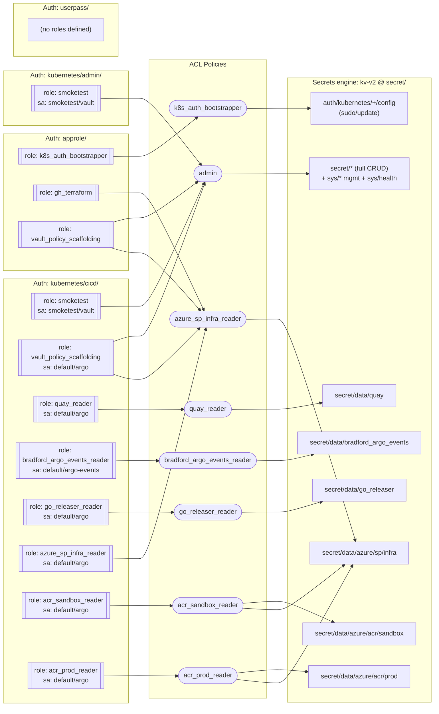

# Architecture

This repo provisions the configuration of a single HashiCorp Vault instance
(`https://bradfordwagner.com:8200`) via Terraform. No application infrastructure is
created — only Vault policies, auth backends/roles, and one secrets mount.

## Module graph

```
                      ┌────────────────┐
                      │ module.policies │  (no dependencies)
                      └───────┬────────┘
              depends_on      │      depends_on
        ┌──────────────────┬──┴───────────────┐
        ▼                  ▼                  ▼
┌───────────────┐  ┌───────────────────┐  ┌──────────────────┐
│ module.approle │  │ module.k8s_clusters│  │ module.userpass  │
│ (auth_approle) │  │ (k8s_auth)         │  │ (auth_userpass)  │
│                │  │ for_each:          │  │                  │
│                │  │  "admin", "cicd"   │  │                  │
└───────────────┘  └───────────────────┘  └──────────────────┘

┌───────────────┐
│ module.secrets │  (no dependencies — mounts kv-v2 at secret/)
└───────────────┘
```

`depends_on = [module.policies]` is explicit because roles reference policy
names as plain strings (`token_policies = ["some_policy"]`), which Terraform
can't infer as a resource dependency.

## Policies (`modules/policies/`)

One `vault_policy` resource per `.hcl` file, wired up in `main.tf`. These names
are the cross-module contract — every auth role below references one of them.

| Policy                        | Grants                                                                                 |
|--------------------------------|-----------------------------------------------------------------------------------------|
| `admin`                        | Broad Vault admin: manage ACL policies, manage all auth methods, full `secret/*`, manage secrets engines/mounts, read `sys/health` |
| `k8s_auth_bootstrapper`         | `sudo`/`update` on `auth/kubernetes/+/config` (configure a kubernetes auth backend)     |
| `quay_reader`                   | Read `secret/data/quay`                                                                 |
| `bradford_argo_events_reader`   | Read `secret/data/bradford_argo_events`                                                 |
| `go_releaser_reader`            | Read `secret/data/go_releaser`                                                           |
| `azure_sp_infra_reader`         | Read `secret/data/azure/sp/infra`                                                        |
| `acr_sandbox_reader`            | Read `secret/data/azure/acr/sandbox` + `secret/data/azure/sp/infra` (needed for the ACR helm login sequence) |
| `acr_prod_reader`               | Read `secret/data/azure/acr/prod` + `secret/data/azure/sp/infra` (same reason)          |

All KV paths follow the kv-v2 `secret/data/...` convention.

## Auth backends

### AppRole (`modules/auth_approle/`)

Enables `approle` at `approle/` (max lease TTL 90d) with three roles:

| Role                        | Policies                                |
|------------------------------|------------------------------------------|
| `k8s_auth_bootstrapper`       | `k8s_auth_bootstrapper`                  |
| `gh_terraform`                | `azure_sp_infra_reader`                  |
| `vault_policy_scaffolding`    | `admin`, `azure_sp_infra_reader`         |

`vault_policy_scaffolding` is the role this repo's own GitHub Actions CI/CD
uses to authenticate to Vault and apply this Terraform.

### Kubernetes (`modules/k8s_auth/`)

Instantiated per cluster via `for_each = var.k8s_clusters` (default:
`["admin", "cicd"]`), each enabling its own `kubernetes` auth backend at
`kubernetes/<cluster>/` (max lease TTL 120s).

- **Every cluster** gets a `smoketest` role — SA `smoketest` in namespace
  `vault`, policy `admin`, 60s token TTL.
- **`cicd` cluster only** (gated with `count = var.k8s_cluster == "cicd" ? 1 : 0`,
  since it's the cluster that runs CI/CD workflows) additionally gets roles
  bound to `argo`/`argo-events` service accounts:

  | Role                              | SA / Namespace           | Policies                          |
  |------------------------------------|--------------------------|------------------------------------|
  | `vault_policy_scaffolding`          | `default` / `argo`       | `admin`, `azure_sp_infra_reader`   |
  | `quay_reader`                       | `default` / `argo`       | `quay_reader`                      |
  | `bradford_argo_events_reader`       | `default` / `argo-events`| `bradford_argo_events_reader`      |
  | `go_releaser_reader`                | `default` / `argo`       | `go_releaser_reader`               |
  | `azure_sp_infra_reader`             | `default` / `argo`       | `azure_sp_infra_reader`            |
  | `acr_sandbox_reader`                | `default` / `argo`       | `acr_sandbox_reader`               |
  | `acr_prod_reader`                   | `default` / `argo`       | `acr_prod_reader`                  |

### Userpass (`modules/auth_userpass/`)

Just enables `userpass` at `userpass/` — no users/roles defined here.

## Secrets engine (`modules/secrets/`)

Mounts `kv-v2` at `secret/` ("static artisinally crafted secrets"). This is
where all the paths referenced by the policies above (`secret/data/...`) live;
actual secret values are managed outside this repo.

## Vault contents (auth methods → roles → policies → secrets)

The diagram below is the runtime view *inside* Vault that all the Terraform
above produces — auth backends and their roles, the ACL policies those roles
are bound to, and the paths (secrets engine or `sys/`) each policy grants
access to.



## CI/CD (informational, not created by Terraform)

Two parallel pipelines drive `terraform plan`/`apply` for this repo, both
described in `CLAUDE.md`:

- **GitHub Actions** (`.github/workflows/`) — workspace matrix from
  `config.yaml`, authenticates via AppRole (`ROLE_ID`/`SECRET_ID`), runs
  `plan` on push and `apply` on tag push.
- **Argo Workflow** (`workflow.yaml`) — legacy entrypoint using the
  `vault_policy_scaffolding` Vault role and an Azure CSI secret (`sp-infra`).

Both consume the `vault_policy_scaffolding` AppRole role and
`cicd_vault_policy_scaffolding`-equivalent k8s role defined above to read
`secret/data/azure/sp/infra` and manage this repo's own state.

## State

Terraform state is stored remotely in Azure Storage (`azurerm` backend,
account/container/key supplied via `backend.hcl`, not checked in with
credentials). The `vault` provider itself is configured purely through the
`VAULT_ADDR`/`VAULT_TOKEN` environment variables — no Vault connection details
live in this repo.
